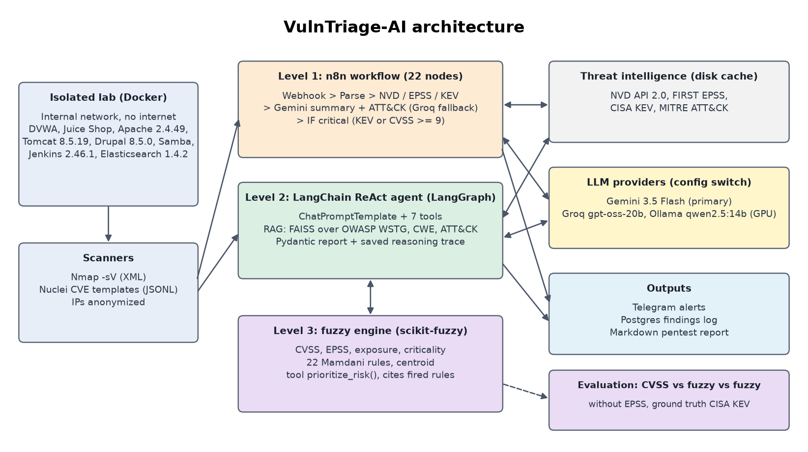
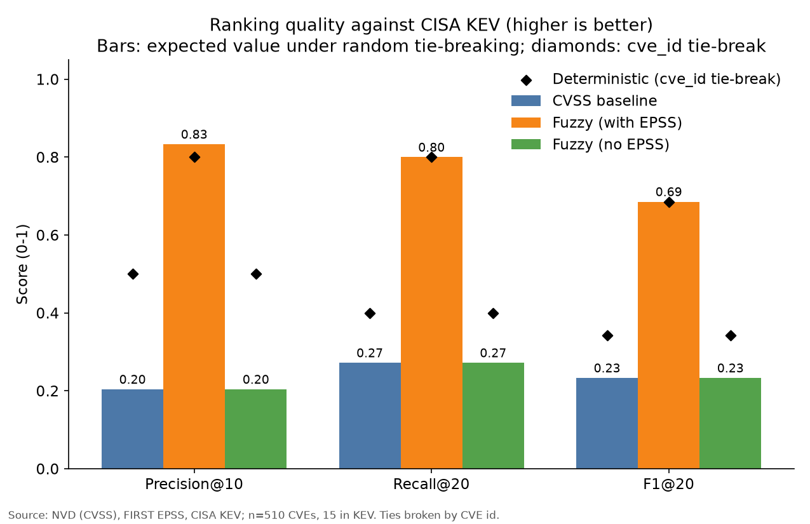
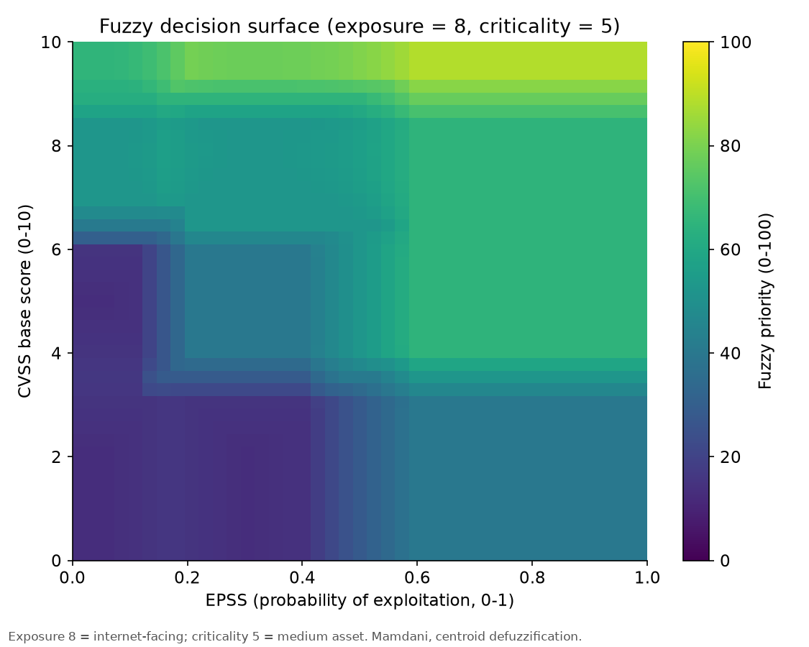

# VulnTriage-AI

An intelligent assistant for vulnerability triage and prioritization in
authorized ethical hacking engagements. It takes Nmap and Nuclei reports from an
isolated lab, enriches every finding with public threat intelligence (NVD, FIRST
EPSS, CISA KEV, MITRE ATT&CK), prioritizes it by real-world risk instead of CVSS
alone, recommends testing and remediation grounded in OWASP and CWE, and drafts
a pentest report.

Intelligent Systems module, Especialización en Inteligencia Artificial, UNAL Sede
Manizales (2026-2). Team: see the course presentation.

| Level | What | Where |
|-------|------|-------|
| 1 | n8n workflow: webhook, enrichment, LLM summary, critical-finding alerts | [`workflow/`](workflow/) |
| 2 | Same use case as a LangChain ReAct agent with RAG and structured output | [`langchain_agent/`](langchain_agent/) |
| 3 | Fuzzy-logic prioritization engine used as an agent tool, evaluated against CVSS | [`fuzzy/`](fuzzy/) |



## Why

A scan of a small lab already returns dozens of services and CVEs. Sorting them
by CVSS is not enough: most high-CVSS vulnerabilities are never exploited, while
some medium ones are. VulnTriage-AI combines CVSS with the probability of
exploitation (EPSS), evidence of exploitation in the wild (CISA KEV) and the
context of the asset (exposure, criticality), and explains its decisions.

## Repository layout

```
docker-compose.yml        n8n Community Edition + Postgres
lab/                      intentionally vulnerable containers (internal network)
scripts/                  lab scan, IP anonymization, secret check
data/lab_scans/           anonymized Nmap XML and Nuclei JSONL reports
data/eval/                evaluation dataset (CVEs with CVSS, EPSS, KEV)
vulntriage/               shared core: config, cached threat-intel clients, parsers
workflow/                 Level 1: n8n workflow (generator, exported JSON, metrics)
langchain_agent/          Level 2: ReAct agent, tools, prompts, RAG index, traces
fuzzy/                    Level 3: fuzzy engine, evaluation script and notebook
reports/                  pentest report drafts produced by the agent
docs/                     proposal, ethical scope, figures
tests/                    pytest suite (offline)
```

## Setup

Requirements: Docker with Compose, [uv](https://docs.astral.sh/uv/), nmap, jq.
Optional: Ollama for the local LLM fallback.

```bash
git clone https://github.com/Jtoro19/vulntriage-ai.git && cd vulntriage-ai
cp .env.example .env        # fill in GOOGLE_API_KEY, GROQ_API_KEY, NVD_API_KEY,
                            # TELEGRAM_BOT_TOKEN, TELEGRAM_CHAT_ID
uv sync                     # Python 3.12 environment with all dependencies
```

Free API keys: Gemini (Google AI Studio), Groq, NVD (nvd.nist.gov/developers),
Telegram bot (BotFather). `.env` is git-ignored and is never printed or committed;
`scripts/check_secrets.sh` blocks a push if a key leaks into a tracked file.

## Reproduce each level

### Lab and scans (shared input)

```bash
docker compose -f lab/docker-compose.lab.yml up -d   # vulnerable containers
./scripts/scan_lab.sh                                # Nmap -sV + Nuclei, anonymized
```

Only the containers on the internal lab network (172.30.0.0/24) are scanned:
DVWA, Juice Shop, Apache httpd 2.4.49, Tomcat 8.5.19, Drupal 8.5.0, Samba, Jenkins,
Elasticsearch, two Java services (Spring WebMVC 5.3.17 on Tomcat, Apache Solr 8.11.0)
and one Python service (a minimal Flask app pinned to Werkzeug 2.2.2 and Jinja2
3.1.2). Nuclei runs without the templates that confirm a bug by exploiting it. See
[docs/ethical_scope.md](docs/ethical_scope.md).

The scan script ends with the **host inventory (lab)** step
(`uv run python -m vulntriage.inventory`): a network scan cannot see process ids,
so this step, running on the Docker host, maps every lab IP and port to its
container and to the PID of the process that owns the listening socket
(`docker network inspect`, `docker inspect`, `docker top`, the container's `/proc`
socket table). Output: `data/inventory/lab_inventory.json`. In a real engagement
this information requires host access granted by the client (an authenticated
scan or an endpoint agent).

### Level 1: n8n

```bash
docker compose up -d                       # n8n 2.48.7 on http://localhost:5678 + Postgres
# first run only: create the owner account in the UI, then the Postgres credential
# (host postgres, db vulntriage, user vulntriage, password vulntriage-local), named
# "VulnTriage Postgres", or import it with `n8n import:credentials`.
./workflow/deploy.sh                       # import, activate, export the workflow
curl -s -X POST http://localhost:5678/webhook/vulntriage -H 'Content-Type: application/json' \
  --data "$(jq -n --rawfile r data/lab_scans/nmap_host12.xml \
    --slurpfile inv data/inventory/lab_inventory.json \
    '{report:$r, asset:"lab-httpd", inventory:$inv[0].entries}')" | jq -r .message
uv run python workflow/measure_executions.py --runs 27   # metrics
```

### Level 2: LangChain agent

LEVEL2_COMMANDS

### Level 3: fuzzy engine and evaluation

```bash
uv run python -m fuzzy.build_dataset       # data/eval/cves.csv (cached API calls)
uv run python -m fuzzy.evaluate            # fuzzy/results/*.json|csv, docs/figures/*.png
uv run jupyter nbconvert --to notebook --execute --inplace fuzzy/evaluation.ipynb
```

### Tests and lint

```bash
uv run pytest -q
uv run ruff check .
```

## Results

All numbers below are read from files produced by the scripts above.

### Level 1: n8n (`workflow/metrics/n8n_metrics.json`)

LEVEL1_METRICS

### Level 2: LangChain agent

LEVEL2_METRICS

### Level 3: fuzzy prioritization (`fuzzy/results/metrics.json`)

Dataset: 510 CVEs (all CVEs linked by NVD to the lab service versions plus a seeded NVD sample), 15 in KEV (2.9%). Ground truth: membership in CISA KEV (exploited in the wild).

| Method | P@10 | R@20 | F1@20 | P@10 (random ties) | R@20 (random ties) | F1@20 (random ties) | Latency (ms per CVE) |
|---|---|---|---|---|---|---|---|
| CVSS baseline | 0.50 | 0.40 | 0.34 | 0.20 | 0.27 | 0.23 | < 0.001 (sort only) |
| Fuzzy (with EPSS) | 0.80 | 0.80 | 0.69 | 0.83 | 0.80 | 0.69 | 0.68 |
| Fuzzy without EPSS (ablation) | 0.50 | 0.40 | 0.34 | 0.20 | 0.27 | 0.23 | 0.54 |

Deterministic columns break ties by CVE id; the random-ties columns are the exact expectation under uniformly random tie-breaking. F1@20 is the harmonic mean of P@20 and R@20.




**Analysis.** The fuzzy engine places 8 of the 15 KEV CVEs in its top 10 and 12 in its top 20, against 5 and 6 for CVSS with a favorable tie-break (about 2 and 4 under random ties, since many CVEs share CVSS 9.8 or 10.0). The ablation without EPSS performs exactly like the CVSS baseline: the improvement comes from the exploitation-probability input, which is also correlated with KEV membership (evaluation bias stated in the proposal). Exposure is almost constant in this dataset (most CVEs are network-reachable), so the context inputs barely change the ranking here. With 15 positives each additional hit moves Recall@20 by 0.067; no statistical significance is claimed. Details, coverage check and rule list: [fuzzy/README.md](fuzzy/README.md) and the executed notebook.

## Alert format

Both pipelines send the same Telegram alert for critical findings (in CISA KEV,
CVSS >= 9, or fuzzy label urgent/high in the agent), one block per finding, in this
order: host IP, PID, service and version, CVE information, recommendation. Real
output of the n8n workflow for the Apache 2.4.49 lab host:

```
[1/3] CVE-2021-41773
1) Host: 172.30.0.12:80
2) PID: 184072 (host inventory (lab))
3) Service: Apache httpd 2.4.49
4) CVE: CVE-2021-41773
   CVSS: 9.8 | EPSS: 1.000
   In KEV: yes
   CWE: CWE-22
   ATT&CK: T1083 File and Directory Discovery
   Priority: n/a in n8n (fuzzy engine runs in the LangChain pipeline)
5) Fix: Update Apache to version 2.4.51 or later and enforce strict access
   controls. Follow OWASP WSTG-ATHZ-01 and CWE-22 guidance.
```

The LangChain agent fills the priority line with the fuzzy result (for example
`88.3/100 (urgent)`). The formatter is `vulntriage/alerts.py`; the n8n version
lives in the "Aggregate run" node.

## PDF triage report

The LangChain pipeline also writes a professional PDF report (ReportLab, pure
Python): cover, executive summary, scope and methodology, a findings table with
the same five fields as the alerts, the ranking by fuzzy priority, four charts
(severity distribution, CVSS vs EPSS colored by KEV, priority ranking, findings
per host), recommendations and an appendix with sources. Sample:
[reports/sample_report.pdf](reports/sample_report.pdf).

## Design decisions

- **n8n with HTTP Request nodes for every API and LLM call.** Keys are read with
  `$env`, so the exported JSON carries no secrets; Gemini has an error output to
  Groq, and if both fail the workflow still logs the threat-intel data.
- **One LLM call per report** in n8n keeps the free-tier quota for 20+ test runs.
- **Gemini Flash as primary LLM** (free tier, strong tool calling), Groq as fast
  cloud fallback and a local Ollama model on the GPU when data must stay on the
  machine. The provider is a configuration switch (`VULNTRIAGE_LLM_PROVIDER`).
- **Disk cache for every threat-intel call** so reruns, tests and the evaluation
  never hit NVD rate limits (50 requests per 30 s with a key).
- **Fuzzy logic for prioritization** because risk is gradual and uncertain, and an
  analyst can read and audit the rules. The rule base is checked for coverage of
  every input-term combination.
- **CISA KEV as ground truth**: the only public, verifiable signal of
  exploitation in the wild. Its correlation with EPSS is measured with an ablation.

## Limitations

- KEV is a proxy for real risk and is correlated with EPSS; the ablation without
  EPSS shows how much of the improvement depends on that variable.
- Exposure and asset criticality are assigned by rule in the lab, not measured.
- Membership functions come from expert judgment, not learned from data.
- CPE-based CVE matching depends on the version string Nmap detects; some
  services (Samba, Jetty snapshot) report version ranges and link no CVE.
- Log4Shell in the Solr 8.11.0 container is present but not detected: Nmap gets
  no Solr version and the Nuclei Log4Shell templates need an out-of-band callback
  server, which an offline lab does not have. Spring4Shell is not confirmed either
  because its templates exploit to confirm and are excluded; Nuclei identifies the
  underlying Tomcat 8.5.77 (CVE-2023-45648) instead.
- PIDs come from the host inventory (lab), which needs access to the Docker host;
  a network-only assessment cannot provide them.
- The ATT&CK mapping in the shared core uses a curated CWE to technique table
  plus keyword search; ATT&CK has no official CWE mapping.
- Free-tier LLM quotas limit throughput; the fallback chain trades quality for
  availability.

## Generative AI use statement

Generative AI (Claude, via Claude Code) assisted this project. It was used to
draft code (workflow generator, threat-intel clients, agent, fuzzy engine,
tests), documentation and the presentation text, following the team's approved
proposal and decisions. Verification: every component was executed end to end
against the lab; every metric in this README and in the presentation was
produced by a script in this repository and read from its output file; tests
(pytest) and the linter (ruff) pass; the team reviewed the code, the fuzzy rules
and the reasoning traces and can explain them. The proposal, the use case, the
selection of tools and the evaluation design are the team's.

## License

Academic project. Lab images are third-party, intentionally vulnerable software:
run them only on an isolated network.
